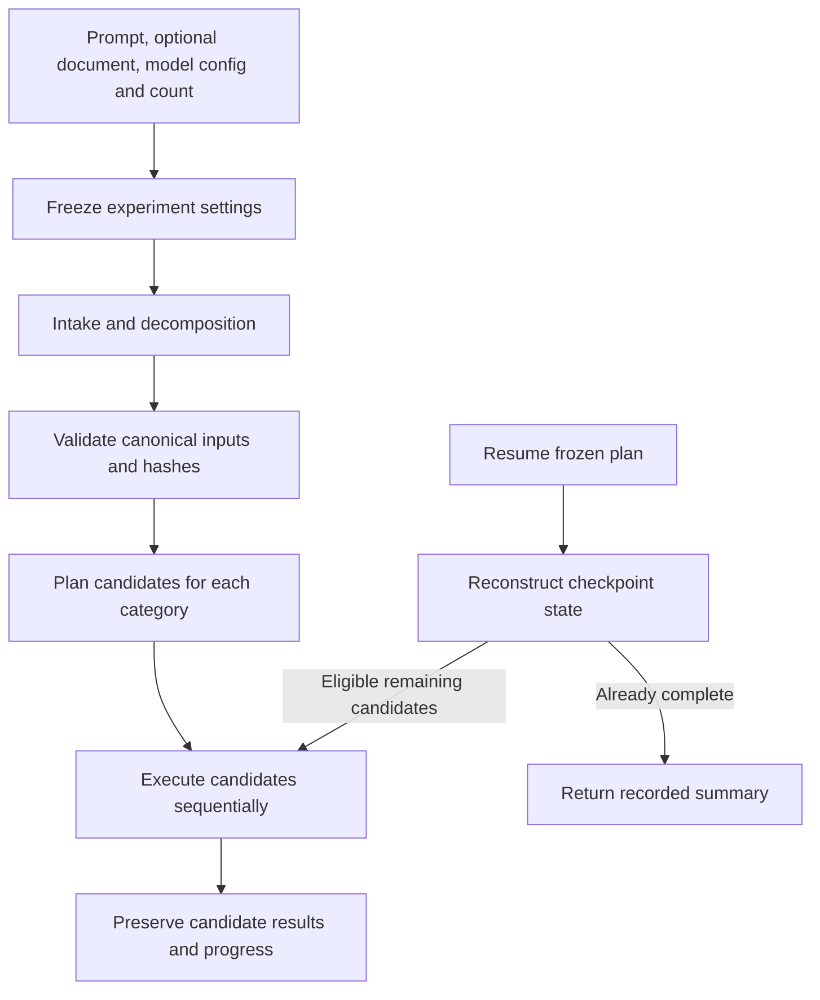

# Start an experiment from a prompt




From the activated `agentic-web` environment:

```powershell
.\run_experiment.ps1 `
  -Prompt "Create a professional personal website from my resume. Do not display my street address or phone number." `
  -Document ".\resume.pdf" `
  -ModelConfig ".\model_configs\nemotron-qwen.json" `
  -Candidates 2
```

Omit `-Document` for a prompt-only request. No resume-specific requirements are
inserted into your prompt. State any content exclusions you need in the prompt.

`-Candidates n` means **n per category**, or **3n total**: control, layout variance,
and architecture variance. All categories use the same model assignments and the
same sequence of seeds, starting at the model config's `seed + 1`.
The default count is 2. Intake/decomposition use the configured seed itself.

`-ManualVerification off` (default) skips human checks and reports uncovered
requirements. Skipped checks never count as passes; a manual-only specification
remains `unverified`. Use `on` to retain the existing manual-review gate.
`-MaxRepairAttempts 2` (default, range 0–10) bounds local Implementer–Verifier
feedback; use 0 for one-pass generation. These settings are frozen in the existing
model configuration and candidate identity. Resume uses the saved settings.

For example, append `-ManualVerification off -MaxRepairAttempts 2` to the command
above. Direct generation supports `--manual-verification off --max-repair-attempts 2`.
Historical plans/configurations that omit both settings retain their existing
manual handling and one-pass execution. No historical plan is rewritten.

The model file uses the existing `ModelConfig` format. `model` selects the
Implementer and is the fallback for unspecified roles. Optional `planner_model`,
`ux_model`, `architect_model`, `coordinator_model`, and `qa_model` select each role.
Intake/decomposition use the Planner; historical semantic review uses QA. Sampling,
token limits, backend URL, and reasoning settings retain their existing meaning.
A minimal single-model file is:

```json
{"model": "google/gemma-4-e4b", "seed": 1024}
```

The launcher performs policy-controlled intake, document conversion if supplied,
decomposition, canonical input validation, experiment planning, a batch dry run,
and actual sequential candidate execution. It uses `resources.local.json`,
`reasoning.example.json`, and `handoff.example.json` by default. A reasoning policy
embedded in the model config takes precedence over the default policy file.
Advanced flags can override the resource/reasoning/handoff file paths or Python
executable. `-HandoffPolicy` accepts the existing `off` and `collaborative` modes.
`-ReviewPolicy` is an explicit historical replay option; it cannot be combined
with `-HandoffPolicy`. All modes call the same intake graph and shared decomposition
implementation. The launcher checks artifact readiness rather than requiring
a reviewer-specific success state.

Each invocation creates a unique directory under `runs/experiments`. It snapshots
the effective model configuration, policies, variance profiles, prompt and optional
document path, and saves all intake, decomposition, candidate and console artifacts.
Inputs are prepared once and frozen for every candidate. Invalid or blocked intake
stops the launcher; it does not silently repair or replace the task.

Resume unstarted candidates using the printed plan path:

```powershell
.\run_experiment.ps1 -ResumePlan "D:\generation-experiment\runs\experiments\<id>\experiment_plan.json"
```

Resume uses saved settings and does not repeat intake or retry terminal failures.
The older `run_resume_experiment.ps1` retains its original fixed six-candidate setup.
