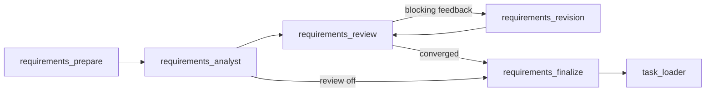

# Requirements analysis feedback

Intake remains one-shot by default. `--review-policy review.example.json` opts into
an initial analysis followed by independent semantic review and at most two
Analyst revisions. Standalone intake and `agentic_web_collaborative` share real
LangGraph nodes and conditional edges:



Errors stop before finalization/generation. The collaborative graph continues from
finalization to the existing decomposition/generation stages as requested;
`analyze_only: true` stops after intake. Existing canonical task inputs bypass these
nodes. Baseline generation, specialists, scheduling and acceptance remain unchanged.

In LangGraph Studio, select the existing **agentic_web_collaborative** graph and use:

```json
{
  "prompt": "Create a responsive website displaying Hello world.",
  "review_policy": {"version": "1.0", "mode": "feedback", "max_revisions": 2},
  "analyze_only": true
}
```

Remove `analyze_only` to continue through website generation. Optional `documents`,
`model_config` and `resource_config` retain their existing input formats. The graph
exposes each draft, review and revision as state updates. Its default recursion
limit accommodates the maximum configured review budget; the policy still limits
actual model revisions. This does not provide automatic crash resume.

```powershell
python -m agentic_web intake `
  --prompt "Generate a personal website from my resume." `
  --document ".\resume.pdf" `
  --output tasks/generated/personal_site_reviewed_v1.json `
  --model google/gemma-4-e4b `
  --review-policy review.example.json `
  --reasoning-policy reasoning.example.json `
  --resource-config resources.local.json `
  --seed 1024
```

Choose a new output filename. No existing manifest or run is overwritten. CLI,
programmatic `build_intake_graph`, and collaborative graph inputs accept the same
`review_policy` object. Use `{"version":"1.0","mode":"off","max_revisions":2}`
for the baseline. Revision budgets range from zero to ten; the default is two.

The reviewer uses `ModelConfig.qa_model` (`--qa-model`) when explicitly set,
otherwise the Analyst's model. It uses the existing QA reasoning policy and
`review_max_tokens`; the Analyst uses the intake reasoning policy and
`planner_max_tokens`. Both use the configured seed, temperature and top-p unchanged
on every call. No model fallback or feedback-driven sampling changes occur.
The existing inference transport retry policy remains separate from revision
counting. Managed calls use the existing resource scheduler and owned-model cleanup.

Deterministic review validates schema, assembled TaskSpec, source quotations,
identifiers, optionality and provenance. Complete malformed/schema-invalid Analyst
outputs can receive feedback; truncated outputs, transport failures and invalid
reviewer responses stop execution. Semantic review compares the original request,
exact document context, current and previous drafts. Findings have category,
severity, observation, exact evidence quotations and optional recommendations.
The Analyst must address each finding with an evidence-backed accept/reject/resolve
decision. The reviewer must reassess every previous finding, including rejected
criticism. Neither agent may silently dismiss an unresolved blocking finding.

Unchanged valid requirement IDs remain stable; restructuring uses explicit
old-to-new requirement lineage. Explicit provenance and mandatory status must be
retained, and recorded prohibitions and explicit runtime/technology constraints
cannot be dropped. These guards do not prescribe layouts or implementation steps.
An unsupported requirement initially mislabeled explicit can be corrected when a
blocking, source-grounded finding identifies its ID, the Analyst accepts/resolves
that criticism, and the subsequent review confirms resolution. This exception and
all decisions are recorded; unchallenged explicit requirements remain protected.
Semantic preservation of meaning is checked by the reviewer, not inferred from
matching identifiers alone.

Every run preserves the original request and exact converted Markdown as before.
Under `<output-stem>.intake/<run>/review/round_NNN/` it additionally saves:

- Analyst/reviewer request schemas, model configuration, resolved reasoning policy,
  raw responses, metrics and existing inference-attempt records.
- The draft, deterministic review, semantic review, feedback, decisions and lineage.
- Resource placement and cleanup records when resource management is enabled.

`review_summary.json` records convergence, revisions, all call metrics and token
totals (including transport attempts), plus the policy and source hashes. Missing
provider usage is explicitly counted, not estimated. Final `analysis.json` includes
the versioned review policy/hash and review provenance. The canonical TaskSpec
schema and its content hash remain unchanged; existing validation, decomposition
and experiment planning continue to consume it. Identical final specifications
retain identical task hashes even if obtained under different review policies;
intake provenance distinguishes their analysis procedures.

Only converged, validated feedback analyses with no blocking input uncertainty and
a supported runtime publish a canonical manifest. `review_exhausted`,
`validation_failed`, `no_progress`, `review_failed`, `interrupted` and `needs_review`
are diagnostic outcomes, not successful finalizations. CLI failures return nonzero.
Completed drafts and diagnostics remain available for inspection. One-shot mode
retains its existing handling of `needs_review` manifests.

Intake and its QA-role reviewer use a 16,384-token default output allowance.
The QA default also applies to downstream QA; explicit smaller limits still win.
Reviewer instructions distinguish evidenced draft defects from speculative implementation
concerns. The same streaming safeguard detects identical top-level review findings,
while allowing distinct findings to share quotations. Paraphrased repetitions are not
detected mechanically.
Requirements instructions group
related source facts into distinct outcomes instead of enumerating duplicate features.
During structured intake streaming, four identical requirement records (ignoring
requirement/test IDs) stop the request with `structured_output_repetition`. This uses
the existing watchdog repetition count. Only requirement entries are compared, so
shared test boilerplate and quoted source text alone do not trigger it. Partial output
and watchdog evidence remain in inference artifacts; incomplete streams are neither
repaired nor retried. Completed analyses also reject duplicate requirement outcomes
and tests under different IDs. This exact-record safeguard does not detect paraphrased
duplicates or guarantee that a model will complete a valid analysis.

Run mocked regression tests with `python -m pytest tests -q`. An optional live smoke test
is explicitly gated and uses the existing model/environment configuration:

```powershell
$env:AGENTIC_WEB_LIVE_INTAKE_REVIEW = "1"
python -m pytest tests/test_intake_review_live.py -q
Remove-Item Env:AGENTIC_WEB_LIVE_INTAKE_REVIEW
```

The live test makes real model calls and may fail if the selected model cannot
produce grounded output within the budget. Semantic completeness and the truth
of a model's interpretation cannot be proven mechanically; reviewers can miss
issues. Using one model for both roles gives distinct prompts, not statistical
independence. Hard process termination may leave a `running` summary; existing
durable inference records and completed rounds remain inspectable. There is no
automatic resume, cross-stage evolution or application repair in this feature.
