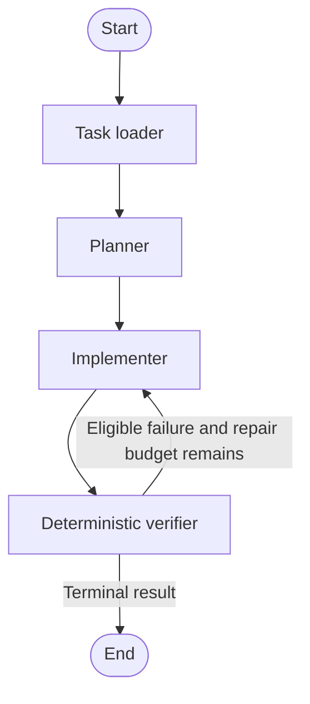
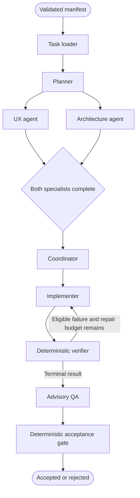

# Phase 2: Heterogeneous Agent Collaboration

The baseline is still the default. The collaborative workflow extends the same task loader, planner, implementation mechanism, verifier and run directory. It adds distinct UX, Architecture, Coordinator and QA nodes plus a deterministic acceptance gate. Task definitions, acceptance thresholds and verifier code are unchanged.

## Graphs

### Baseline



### Collaborative generation



The Coordinator uses a LangGraph join edge and executes once after both branches finish. Each branch writes a separate typed state field and separate error field. Neither specialist receives its sibling's analysis. Independent model calls run concurrently without a shared inference lock. Optional resource placement prepares both specialists before the existing fork; see [RESOURCE_PLACEMENT.md](RESOURCE_PLACEMENT.md). Bounded repair uses the existing Implementer node; no separate repair agent or prompt optimizer is added.

A1 integrates a `requirements_analyst` node into this same collaborative graph. With `prompt` (or free-text `requirements`) and no manifest, `START` routes through analysis before `task_loader`; ready specifications proceed through the stages above. Blocking missing information, unsupported runtime needs and analysis failures stop before generation. `analyze_only: true` previews analysis in this graph. Existing `task_path`/`task_spec` inputs bypass analysis, preserving independent candidate experiments from a canonical manifest. See [A1.md](A1.md#interactive-testing-in-langgraph-studio).

A3 adds an optional `task_decomposition` node before `task_loader`. With `decompose: true`, a canonical input routes directly to decomposition; natural/document requests route through A1/A2 first. `decompose_only: true` inspects canonical tasks without candidate generation, and `decomposition_path` reuses a frozen artifact. Blocked/unsupported decompositions remain inspectable and stop before the candidate Planner. Default inputs bypass this node, and specialist parallelism and acceptance authority are unchanged. See [A3.md](A3.md).

Studio exposes `agentic_web` (baseline), the existing `eventhub` baseline alias, and `agentic_web_collaborative`. Their module-level exports are `app` and `collaborative_app` in `agentic_web/workflow.py`. Imports do not invoke a workflow or contact LM Studio.

## PowerShell commands

```powershell
conda activate agentic-web
cd D:\generation-experiment
python -m agentic_web models
python -m agentic_web validate --task tasks/todo.json

# Baseline: existing flags and behavior
python -m agentic_web generate `
  --workflow baseline `
  --task tasks/todo.json `
  --planner-model google/gemma-4-e4b `
  --model qwen2.5-coder-7b-instruct `
  --planner-max-tokens 2048 `
  --max-tokens 8192 `
  --seed 1025 `
  --output runs

# Collaborative: provisional model assignments
python -m agentic_web generate `
  --workflow collaborative `
  --task tasks/todo.json `
  --planner-model google/gemma-4-e4b `
  --ux-model ministral-3-8b-reasoning-2512 `
  --architect-model qwen2.5-coder-7b-instruct `
  --coordinator-model google/gemma-4-e4b `
  --model qwen2.5-coder-7b-instruct `
  --qa-model microsoft/phi-4-mini-reasoning `
  --planner-max-tokens 2048 `
  --review-max-tokens 3072 `
  --max-tokens 8192 `
  --seed 1025 `
  --output runs

langgraph dev
```

Replace `tasks/todo.json` with `tasks/eventhub.json` or `tasks/catalog.json` for the other fixtures. `--workflow baseline` can be omitted. Existing `--temperature`, `--top-p`, `--base-url`, screenshot and verification timeout flags remain available.

Token limits are optional: planner_max_tokens, review_max_tokens and max_tokens default to null/None. With no limit flag, max_tokens is omitted from the API request; server/model limits still apply. The commands and example configuration above intentionally supply explicit caps, which remain supported. All roles reject length-terminated output as incomplete before accepting structured data or HTML, retaining raw responses, requested limits, actual usage and finish reasons. QA truncation is recorded separately from deterministic application acceptance.

Role flags configure model identifiers independently of roles. Unspecified role models deliberately inherit `--model`; a requested model is never silently substituted. Common sampling settings apply to all agents. Planner token limits use `--planner-max-tokens`; specialist, Coordinator and QA limits use `--review-max-tokens`; implementation uses `--max-tokens`. Seeds are base seed for Planner, base+1 for Implementer, base+2 for UX, base+3 for Architect, base+4 for Coordinator and base+5 for QA. Model metrics retain the server-returned model ID and usage when available.

`phase2_models.json` is an optional example `ModelConfig` for Studio/programmatic input, not an automatically loaded CLI configuration. Example Studio input:

```json
{
  "task_path": "tasks/todo.json",
  "model_config": {
    "planner_model": "google/gemma-4-e4b",
    "ux_model": "ministral-3-8b-reasoning-2512",
    "architect_model": "qwen2.5-coder-7b-instruct",
    "coordinator_model": "google/gemma-4-e4b",
    "model": "qwen2.5-coder-7b-instruct",
    "qa_model": "microsoft/phi-4-mini-reasoning"
  },
  "output_root": "runs"
}
```

## Availability and authority

LM Studio defaults to `http://127.0.0.1:1234/v1`. Use exact identifiers returned by `models`; the provisional names above may need adjustment for your installation. Collaborative task intake lists exposed models and reports missing IDs before generation. Missing Planner, UX, Architect, Coordinator or Implementer IDs reject the run. Missing QA is recorded separately and does not block generation or deterministic acceptance. Inference/transport failures remain explicit and include the requested role/model.

The exposed model list is not proof of residency or sufficient GPU memory. Manually manage model availability in LM Studio. The framework does not load/download/offload models or require concurrent specialist inference. Any server-side JIT model behavior remains LM Studio's configuration.

Original requirements and validated task specifications remain authoritative and fingerprinted. Acceptance contracts take precedence over all agent advice. Specialists return Pydantic-validated reviews with requirement references; the Coordinator preserves the acceptance-contract fingerprint, runtime and technology constraints and traces every mandatory requirement to instructions. The Implementer receives the coordinated specification alongside the unchanged task, plan and mandatory contract.

QA runs after passing, failed or unverified deterministic reports when source and verification evidence are available. Its input includes actual diagnostics, source excerpts and coordinated context. The supplied evidence registry is the sole valid namespace for evidence references; source text remains analysis context. Quotes must be exact contiguous substrings of the named registry value, and ellipses are rejected. Every finding labels itself as a primary defect, secondary symptom or independent issue. When deterministic evidence contains a JavaScript syntax error followed by interaction timeouts, QA must ground an observed runtime-exception primary defect in the syntax diagnostic and classify downstream non-runtime findings as secondary symptoms. Findings still distinguish observations from hypotheses, reference known requirements/tests and cannot relabel test outcomes. QA writes reports only; it never edits generated code or performs repairs.

The QA response schema specializes the existing Pydantic review model for each run. `requirement_ids` and `test_ids` have separate enums derived from the validated manifest; a test's `requirement_id` supplies the link between them. Evidence references use `anyOf` alternatives binding allowed keys to their exact full registry values, preventing mismatched pairs such as a failed overall status quoted as passed. Requests retain this derived schema in `qa_request.json`. Pydantic parsing and all existing reference, evidence, outcome and diagnostic checks still run. Unsupported schema features fail explicitly without fallback; schema constraints cannot establish that a model's prose diagnosis is correct.

The gate checks deterministic status, universal checks/errors, mandatory coverage, required test results and artifact existence. Missing or inconsistent evidence cannot pass. QA is never a gate input for correctness. A passing artifact remains accepted if QA fails, with `qa_status: failed` and `qa_error` recorded separately. Unverified mandatory requirements are rejected while preserving the `unverified` status. Runs failing before verification are rejected, and QA is marked skipped when evidence is insufficient.

## Artifacts and ledger

Existing artifacts remain. Additional collaborative artifacts include:

```text
models_available.json / model_availability.json
ux_request.json / ux_raw.txt / ux_metrics.json / ux_review.json
architect_request.json / architect_raw.txt / architect_metrics.json / architecture_review.json
coordinator_request.json / coordinator_raw.txt / coordinator_metrics.json / coordination.json
qa_request.json / qa_raw.txt / qa_metrics.json / qa_review.json
<role>_error.json (on failure)
acceptance.json
ledger/task_loader.json, planner.json, ux.json, architect.json,
       coordinator.json, implementer.json, verifier.json, qa.json, acceptance_gate.json
```

The baseline also records its four stage events. Ledger entries use exclusive creation and never rewrite a previous stage record. They contain timestamps, the authoritative requirement fingerprint, input hashes, artifact SHA-256 hashes and stage status/error details. Metadata retains its existing live status updates. This is an append-only application ledger with tamper-evident artifact hashes, not OS-enforced immutable storage. Historical run directories are not modified.

## Validation

```powershell
python -m unittest discover -s tests -v
python tests/mock_collaboration_demo.py
```

The full suite passed **100 tests, 0 failures, 0 skipped**. The 59 earlier regressions, nine optional-token-limit regressions and eleven structured-output regressions remain covered; 21 Phase 2 tests exercise branch independence/joining, heterogeneous role configuration, structured conflict resolution, implementation inputs, actual QA evidence, QA isolation, failed/unverified/incomplete executions, unavailable models, artifacts and ledger hashes, CLI routing, Studio schemas, and real Chromium integration for all three applications.

Persisted demonstrations use mocked model responses and real Chromium; all were accepted with completed QA:

- EventHub: `runs/collaborative_mocked/20261009T215958-27b1c263da0d40d59419520f8c85e743`
- Task Tracker: `runs/collaborative_mocked/20261009T220000-216b02cc607b42e78e4b278b7e5442e6`
- Product Catalog: `runs/collaborative_mocked/20261009T220002-23eac5d4a8574ace9989c201c2566d01`

LangGraph's actual development server loaded all three graph IDs. Its assistant schema endpoints returned valid input/output schemas, and graph endpoints exposed the expected baseline/collaborative nodes. The temporary validation server was stopped after inspection.

No live generations or model downloads were performed in this phase. Next validate the configured local model IDs, structured JSON reliability, context/token limits, specialist quality, coordination quality and QA evidence interpretation with manually managed live LM Studio models. Mocked reasoning does not establish the capabilities or quality of the provisional models.

Only `single_html` remains supported. Prompt optimization, automated repair, runtime expansion and model residency/scheduling remain future work.

## Files

Created: `agentic_web/collaboration.py`, `agentic_web/collaboration_schema.py`, `agentic_web/provenance.py`, `phase2_models.json`, `tests/collaboration_mock_client.py`, `tests/test_collaboration.py`, `tests/mock_collaboration_demo.py`, and this document.

Modified: `agentic_web/workflow.py`, `agentic_web/client.py`, `agentic_web/__main__.py`, `langgraph.json`, `tests/test_framework.py`, `README.md`, and `architecture.md`. No task manifests, acceptance thresholds, verifier code, environments or inference dependencies were changed.

## Structured-output compatibility

Planner, UX, Architecture, Coordinator and QA now request strict JSON Schema generation through LM Studio's OpenAI-compatible response_format mechanism. Schemas come directly from the existing Pydantic models, preserving their actual roots and nested definitions. HTML implementation remains unconstrained by JSON Schema. Prompt instructions supplement the protocol constraint; Pydantic validation and requirement/evidence checks still govern downstream use. Unexpected named wrappers and malformed JSON are never unwrapped or semantically repaired.

Unsupported schema formats/features or SDK parameters produce explicit errors and retained backend diagnostics, with no unconstrained fallback or retry. Schemas are not rewritten to fit a backend's narrower subset. Capability checks remain limited by backend responses: a silent format ignore is detectable when returned data fails validation, but valid JSON alone cannot prove the server enforced its grammar. Live model/backend support and reasoning-model behavior require validation; no costly live generation was run for this change. QA format/validation failures remain advisory and cannot override deterministic artifact acceptance.

The additive inference-interface argument is response_schema (a Pydantic model class or None). Custom adapters must accept it. Additional artifacts are <role>_validation_error.json and <role>_structured_output_error.json; request files record response_format and response metrics identify response_schema. Source: [LM Studio structured-output documentation](https://lmstudio.ai/docs/developer/openai-compat/structured-output).
