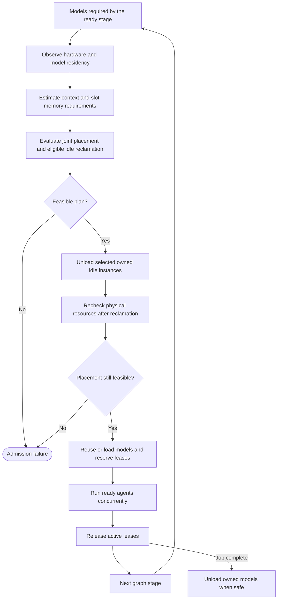

# Resource-aware placement



This depicts the current local scheduler, including its single post-reclamation replan. It does not imply remote-node routing or repeated reclamation after a downgrade. Active, reserved, externally owned and shared instances remain protected.


Enable placement with `generate --resource-config resources.local.json`. Baseline and collaborative graph dependencies, schemas, contracts and verification are unchanged. UX and Architecture execute concurrently; their models are admitted together before the existing fork. Without this flag, model residency remains manually managed, and independent calls still have no framework inference lock.

`hardware.py` discovers NVIDIA GPUs through `nvidia-smi` and physical available RAM through the OS. `resource_scheduler.py` contains backend-independent admission and residency leases. `lmstudio_placement.py` implements the local LM Studio adapter. Another backend can implement `PlacementBackend` and supply its hardware discovery to `ResourceScheduler`, then inject it through `build_graph(resource_scheduler=...)`.

The deterministic policy prioritizes the agents ready in the current stage. It compares placement with current residency against placement after reclaiming scheduler-owned idle instances, scoring each ready model by estimated CPU cost multiplied by its GPU-offload fraction. The LM Studio adapter obtains native estimates for 25%, 50%, 75%, and 100% offload. It therefore moves an expensive ready model to the largest safe GPU fraction when full offload does not fit, instead of leaving a cheaper idle model on GPU while running the ready model entirely on CPU. After unloading the selected idle instances, the scheduler discovers physical GPU/RAM availability again and recomputes the placement. This matters because an estimate is an admission bound and can exceed the memory the backend actually committed; estimated freed bytes are never treated as the final load budget. Cost uses parameter count, configured context and concurrent slots, rather than role or model names. It preloads every required model only when all of them fit at 100% GPU offload. Context/parallel-specific native estimates include KV cache and inference overhead; padding and separate GPU/RAM safety reserves apply. GPU placements conservatively reserve host weight memory too. CPU mode can retain GPU overhead: this is budgeted on every visible GPU because its device is unknown. Infeasible placements fail explicitly.

Locks cover accounting and residency changes only. Each ready role pins its instance before inference; active or pinned instances cannot be evicted. An idle instance shared with another in-process job is also protected between stages. Native busy/queued checks protect backend instances. The pool is shared across compiled graphs using the same endpoint in one Python process; it does not coordinate independent OS processes. Only scheduler-owned idle instances used exclusively by the current job can be reclaimed. Existing manually loaded models consume observed free memory and are preserved. Native inventory does not expose weight placement; to reuse a manual instance, supply its operator-verified device in `resident_devices`, for example `{"my-instance-id": "cpu"}`. Do not infer weight placement from KV-cache offload metadata. Disable backend auto-eviction when using concurrent managed instances; preparation checks that all admitted instances remain visible.

The installed CLI exposes `--gpu off|max|<ratio>`, context, identifier, estimate-only and parallel slots. These controls are used through argv, while inventory and unload use native REST. The documented [REST load API](https://lmstudio.ai/docs/developer/rest/load) does not advertise weight offload or GPU device selection; the [CLI load API](https://lmstudio.ai/docs/cli/local-models/load) provides offload controls. No unsupported REST parameters or GPU-device CLI flags are sent. The installed CLI lacks explicit device selection, so this adapter supports full or partial GPU placement on a single visible GPU and conservatively uses CPU placement on multi-GPU hosts. The scheduler supports explicit multi-GPU placement through capable adapters; automated tests simulate that capability. No HPC backend is included.

New run files are `resource_config.json`, `resources.<stage>.json` and `resources.inference.<role>.json`, included in the existing role ledger. They record hardware snapshots, estimates and raw estimator diagnostics, placement/admission failures, model/device/offload assignments, residency/reuse, loading/unloading durations, inference wall time, client lease queueing, token usage and finish/completion status. Backend-internal queue latency and a true memory high-water mark are unavailable: `peak_memory_bytes` is null and the separately named sampled device peak uses only start/end observations. Existing model timing metrics remain intact. These observations include other processes' memory. At job completion, including handled failures, cleanup unloads scheduler-owned instances, including unused prefetched models. Pre-existing instances remain untouched. Instances shared with another job remain resident until the last job finishes, and active or reserved instances cannot be unloaded. Cleanup failures are retained in resources.cleanup.json, metadata and a separate resource_cleanup ledger record without replacing the application verification result. Historical artifacts are never rewritten.

Run these commands from `D:\generation-experiment` with LM Studio serving on port 1234:

```powershell
conda activate agentic-web
$env:PATH = "$env:USERPROFILE\.lmstudio\bin;" + $env:PATH
lms load --help
lms ps --json
nvidia-smi --query-gpu=index,name,memory.total,memory.free --format=csv,noheader,nounits
python -m agentic_web resources --resource-config resources.local.json --models ministral-3-8b-reasoning-2512 qwen2.5-coder-7b-instruct
python -m unittest discover -s tests -v
python -m agentic_web generate `
  --task tasks/todo.json --workflow collaborative `
  --planner-model google/gemma-4-e4b `
  --ux-model ministral-3-8b-reasoning-2512 `
  --architect-model microsoft/phi-4-mini-reasoning `
  --coordinator-model google/gemma-4-e4b `
  --model qwen2.5-coder-7b-instruct `
  --qa-model microsoft/phi-4-mini-reasoning `
  --resource-config resources.local.json --seed 1025 --output runs
```

`resources` performs discovery and native memory estimates without loading, unloading or inference, and saves a new `runs/resource_checks/<uuid>/inspection.json`. The resource-setting default and example context are 32768 tokens (the example uses parallel slots 1); context controls residency sizing, not output length. Client output limits remain optional. Adjust the resource file for your application's context needs and hardware reserves; no automatic context reduction occurs.

On this RTX 5070 host, the read-only check succeeded and admitted both requested models on CPU because existing manually loaded models left too little GPU memory. Live placement/load/unload and simultaneous model inference are not asserted by that inspection; those paths are covered with mocked native/backend controls and overlapping inference tests. Unit tests cover single/multiple GPU admission, heavier-model preference, CPU/GPU overlap, shared-model slots, HPC-sized residency, reuse, protected active/reserved instances, explicit infeasibility, unsupported controls, and both workflows.
