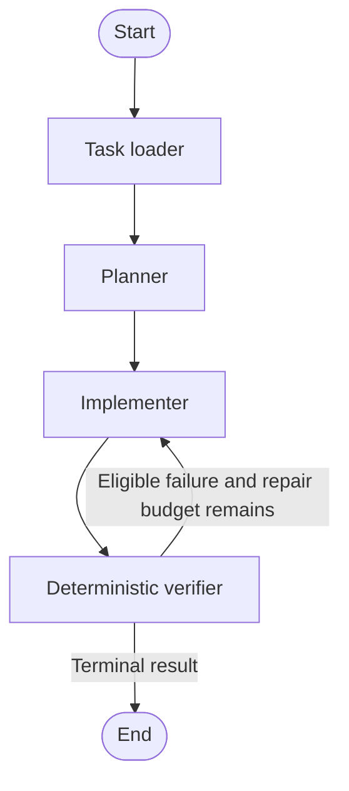
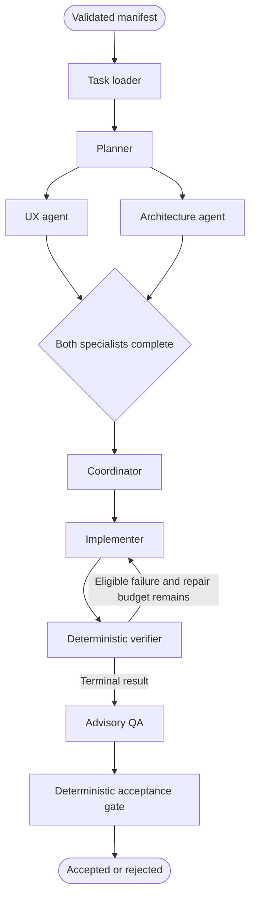

# Implemented architecture

The framework uses the same task contracts, inference interface and deterministic verifier for baseline and collaborative generation. Runtime support is currently limited to standalone HTML with inline CSS and JavaScript.

## Baseline generation

## Collaborative generation

UX and Architecture run independently in parallel. The Coordinator joins both results. Validation or inference failures stop downstream generation; QA is advisory and cannot override deterministic acceptance. The repair edge is conditional on actionable verification evidence and the configured budget.

Natural-language and document inputs pass through the shared [intake and handoff workflow](HANDOFFS.md) before generation. Frozen manifests bypass analysis. Requirement-level decomposition can be reused across candidates; candidate-specific planning remains separate.

[Resource placement](RESOURCE_PLACEMENT.md) manages local model residency outside graph inference dependencies. Each stage preserves requests, responses, metrics and validation diagnostics. See [Phase 2](PHASE2.md) for agent contracts and the [launcher guide](EXPERIMENT_LAUNCHER.md) for execution.
