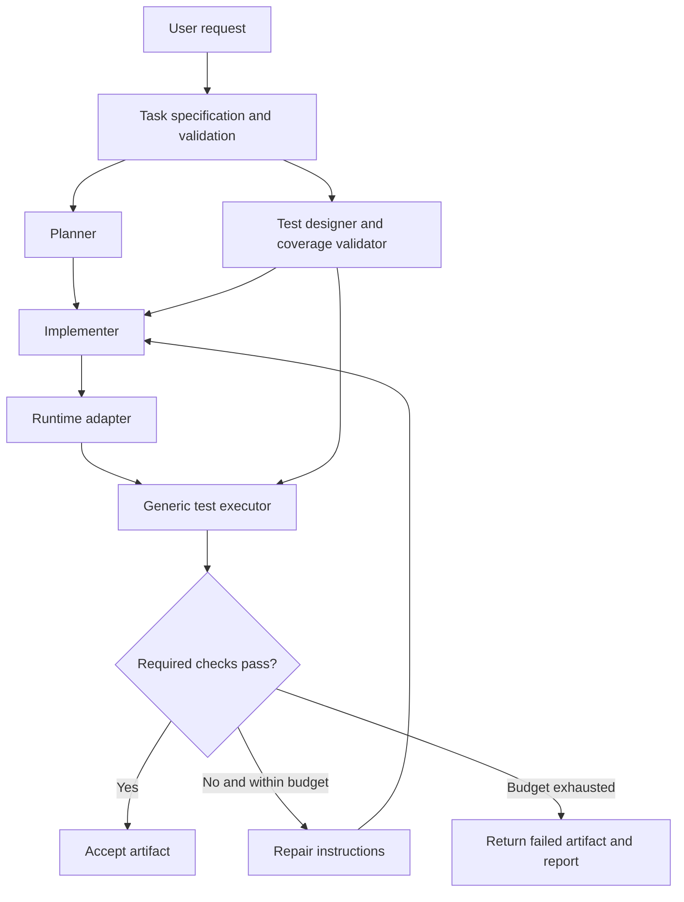

# Generalized Agentic Web Architecture

## Decision

The framework must generate and evaluate **any supported website or web application**, not only EventHub. EventHub becomes an example task, not an architectural dependency.

## Architectural boundaries

1. **Task specification** (`web_task_spec.py`, `tasks/*.json`): user goals, required capabilities, acceptance criteria, technology/runtime constraints. The original requirements remain immutable.
2. **Specification/coverage review** (planned): validates that normalized requirements and acceptance criteria are traceable to the original user request. Ambiguous requirements are flagged rather than invented.
3. **Planner**: constructs a design/implementation plan appropriate to the task; does not add unrequested capabilities as mandatory requirements.
4. **Test designer** (planned): generates a structured, machine-readable test plan from the approved task specification **before** implementation. Selectors/testability hooks may be negotiated, without requiring any fixed design.
5. **Implementer**: generates the requested artifact: a single HTML file, a multi-file static site, or a frontend/backend application.
6. **Runtime adapter** (planned): renders single HTML artifacts, serves static sites, or starts a previously approved local backend environment. Model-generated shell commands must not run automatically.
7. **Generic verifier** (planned): runs universal smoke checks plus the task's generated browser/API tests, with bounded timeouts, network isolation, and per-test outcomes.
8. **Repair loop** (planned): uses concrete verification failures, retains all versions, and respects retry/token budgets.



## Different evaluation profiles

| Artifact | Shared checks | Conditional checks |
| --- | --- | --- |
| Single HTML | Load, JS exceptions, responsive viewport, basic accessibility | Search, forms, event registration, todo management, etc. from spec |
| Multi-file static website | Load through local HTTP, JS errors, navigation, broken assets | Inter-page links, dynamic filters, client-side storage |
| Frontend/backend web app | Service health, browser load, exceptions | API status/body, CRUD state, persistence, authentication, authorization, multi-user workflows |

## Why test plans must be generated from requirements, not source code

If the implementer and verifier derive acceptance criteria solely from the generated application, missing features can be falsely treated as acceptable. Instead, a Test Designer converts original requirements into behavior assertions **before seeing implementation code**. After code generation, locator binding may use semantics, labels, roles, or stable `data-testid` attributes, but the *expected behavior cannot change*.

Keep a separate test-coverage record: `feature_id -> test_case_ids -> result`. Unsupported or untestable required features are marked **unverified**, never passed by default. A human-reviewed/approved plan is preferable for security-sensitive operations.

## Dynamic test-plan format (planned)

Example from an event-search specification:

```json
{
  "feature_id": "search",
  "test_id": "matching_search_filters_results",
  "kind": "browser",
  "preconditions": ["at least two searchable events exist"],
  "steps": [
    {"action": "fill", "target": {"test_id": "event-search"}, "value": "a known event name"},
    {"action": "assert_visible_matches", "target": {"test_id": "event-card"}, "rule": "only_matching_events"}
  ]
}
```

This is a design illustration, **not yet an executable generic test schema**. The full schema should use a limited, validated Playwright action vocabulary, not arbitrary model-generated Python or JavaScript. Test data should be generated consistently and safely, with explicit fixtures where needed.

## Migration from your existing files

- **Keep:** `browser_verifier.py` as the first static/single-file smoke adapter; update it later for other runtime types.
- **Replace as a core dependency:** `functional_verifier.py`. It may remain in `legacy/` as an EventHub-specific baseline, but it cannot be the universal verifier.
- **Update:** `test_langgraph.py` so its initial state is a task ID/specification, not EventHub-specific requirements baked into prompts.
- **Change:** `implementer()` so technology and artifact restrictions come from the task specification, not a globally fixed single-HTML prompt.
- **Add later:** `test_designer` and `test_plan_validator` nodes, followed by an `artifact_runtime` and `generic_verifier` node.

## Validate task contracts (Conda)

Place `web_task_spec.py` in the project root, and the sample manifests under `tasks/`.

```powershell
conda activate agentic-web
cd agentic-web-research
python -m pip install "pydantic>=2"
python .\web_task_spec.py validate .\tasks\eventhub.json
python .\web_task_spec.py validate .\tasks\todo.json
python .\web_task_spec.py validate .\tasks\inventory_webapp.json
```

This step only validates input task specifications. It does **not** generate dynamic tests or execute a web app yet.

## Suggested graph-state evolution

```python
class WorkflowState(TypedDict):
    task_id: str
    task_spec: NotRequired[dict]
    plan: NotRequired[str]
    test_plan: NotRequired[dict]
    artifact: NotRequired[dict]  # kind, entrypoint, base_url, output_dir
    verification: NotRequired[dict]
    result: NotRequired[str]
```

The graph must preserve `task_spec` immutably. Each agent's output should be a new field, not a mutation of the original requirement contract.

## Next implementation checkpoint

**Next milestone:** Add the `test_designer` node, strict JSON schema for allowed browser/API assertions, traceable feature coverage, and a **generic test executor**. Test it against both EventHub and Todo first; then add the local-service web-app runtime. Do not add multi-model routing or residency management until the task-neutral verification foundation works.
